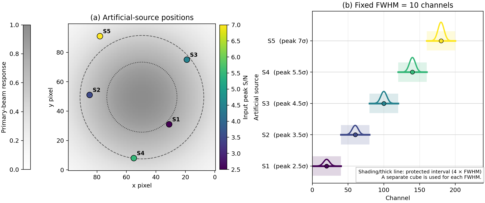

# ALMA line search and detectability guide

This guide is for a user who has an ALMA measurement set (MS) and wants to:

1. perform a reproducible untargeted emission- or absorption-line search; and
2. measure the completeness and contamination of that search with artificial
   sources.

The candidate search is one component of the workflow rather than its final
scientific objective. The measured completeness, contamination, flux recovery,
and astrometric accuracy describe how an underlying source population is mapped
into the resulting catalogue and can be propagated into corrected source counts
or luminosity-function constraints.

DICE is still under active development. The low-level extraction, injection,
and recovery functions are usable, but there is not yet a single supported
command that safely chooses all imaging and search parameters for an arbitrary
ALMA data set. Record every choice listed below and validate the workflow on a
small subset before launching a large injection run.

## 1. Preserve the observation

Never inject sources into the only copy of a calibrated MS. Keep these as
separate products:

```text
calibrated.ms                 # immutable calibrated input
calibrated.contsub.ms         # continuum-subtracted search input
blank_000.ms ...              # independent working copies for injections
products/
  native_dirty/
  search/
  injection_recovery/
  manifests/
```

Record the following before processing:

- ALMA project code, target, execution blocks, CASA and pipeline versions;
- selected fields, SPWs, channel ranges, intents, and data column;
- flagged fraction and the distribution of visibility weights;
- phase centre, frequency frame, channel width, and rest frequency;
- imaging grid, weighting, synthesized beam, PB cutoff, and search region.

Archive a text or JSON manifest with the exact commands and parameters. Do not
put large MS, CASA image tables, or proprietary data in Git.

## 2. Audit the MS

Use CASA `listobs`, `msmd`, and table inspection before continuum subtraction.
Check that the intended science target and SPWs are present, that the corrected
data column exists, and that the channel ordering and frequency frame are
understood. Inspect amplitudes, weights, and flags rather than assuming that
the delivered MS is uniform.

Particular warning signs are:

- mixed array configurations or substantially different beams;
- SPWs with different channel widths;
- strong spectral lines in channels intended for continuum fitting;
- bright continuum sources or calibration residuals;
- severe flagging, non-uniform weights, or image edges with incomplete PB
  coverage.

## 3. Make a continuum image and inspect data quality

Before continuum subtraction or an untargeted line search, make a continuum image
from channels believed to be line-free. The continuum image provides a simple
first check of calibration quality and identifies sources whose sidelobes or
dynamic-range residuals may affect the cube.

Use the same field selection, weighting philosophy, and image extent intended
for the line cube. Record the continuum-channel selection separately from the
final selection used for `uvcontsub`.

Run a preliminary positive and negative continuum search. DICE can provide a
candidate list without deciding which regions should be masked:

```python
from bliss_alma.extraction import extract_sources

positive = extract_sources(
    continuum_image,
    seed_sigma=5.0,
    flood_sigma=3.0,
    min_pixels=5,
    polarity="positive",
    detection_mask=outside_pb,
)
negative = extract_sources(
    continuum_image,
    seed_sigma=5.0,
    flood_sigma=3.0,
    min_pixels=5,
    polarity="negative",
    detection_mask=outside_pb,
)
```

Also inspect the pixel-value distribution before searching for lines. Produce
at least:

- a histogram of continuum-image pixels in units of the measured RMS;
- positive and negative tails shown on the same logarithmic count scale;
- a Gaussian reference with the same normalization;
- pixel histograms for representative and suspicious cube channels;
- RMS, median, skewness, and robust tail counts versus channel;
- representative channel maps and spectra around bright continuum sources.

Compute these distributions inside a clearly defined PB region and initially
exclude only invalid or non-finite pixels. Image pixels are correlated by the
synthesized beam, so a histogram is a quality diagnostic rather than a count
of independent statistical trials.

Features that should trigger closer inspection include:

- asymmetric positive and negative tails;
- an excess in both tails relative to a Gaussian;
- a non-zero median or channel-dependent baseline;
- isolated channels with high RMS;
- structures aligned with the dirty beam around bright sources;
- abrupt changes associated with SPW edges, flagging, or atmospheric features.

The user should inspect these products and define the science, bright-source,
artefact, and noise-estimation masks manually. DICE should save and apply those
masks reproducibly, but should not silently decide which real emission is an
artefact. Save the mask itself, its coordinate system, the reason for each
masked region, and separate masks for:

- RMS estimation;
- source detection;
- known real sources used when classifying unmatched detections;
- continuum normalization in an absorption search.

After masking, regenerate the pixel distributions. Report both the initial
distribution and the masked distribution so that the effect of masking remains
visible.

## 4. Continuum subtraction

Define line-free channels from the data and subtract the continuum in the
visibility domain when an MS is available. A typical modern CASA call is:

```python
from casatasks import uvcontsub

# Replace this example with the line-free channels in your own data.
line_free_channels = "0:10~50;80~120,1:5~45;75~115"
uvcontsub(
    vis="calibrated.ms",
    outputvis="calibrated.contsub.ms",
    spw="0,1",
    datacolumn="corrected",
    fitspec=line_free_channels,
    fitmethod="gsl",
    fitorder=0,
    writemodel=False,
)
```

The exact `fitspec`, fit order, and SPW combination must be justified for the
data. Inspect spectra and residual images after subtraction. Image-plane
continuum subtraction is useful when only a cube is available, but it is not
identical to visibility-domain subtraction and must be labelled as such.

For absorption searches, retain a continuum image and continuum-source mask.
The default candidate search should use negative extraction from a
continuum-subtracted cube. Continuum-normalized representations are optional
products for cases with an independently validated continuum model; exclude
pixels where the continuum is too weak for stable normalization.

### Optional absorption-depth representations

DICE provides three positive-valued representations through
`bliss_alma.spectral.absorption_cube`:

- `residual_depth`: `I_continuum - I`, in the original image units;
- `fractional_depth`: `1 - I / I_continuum`, for comparing sightlines with
  different continuum brightness;
- `optical_depth`: `-ln(I / I_continuum)`, an apparent optical-depth cube for
  comparing absorption strength and kinematics after candidate identification.

The optical-depth representation is not the default detection product and
must not automatically be interpreted as the physical optical depth. Weak or
non-positive continuum pixels must be masked. Partial covering of the
background source, emission filling, continuum-model uncertainty,
interferometric filtering, calibration residuals, and deconvolution artefacts
can all change the apparent depth.

For a validated continuum model, the conversion can be run explicitly:

```python
from bliss_alma.spectral import absorption_cube, extract_absorption_lines

depth = absorption_cube(
    cube,
    continuum_model,
    representation="residual_depth",
)

candidates = extract_absorption_lines(
    cube,
    continuum_model,
    representation="residual_depth",
    rms=rms_in_depth_units,
    seed_sigma=5.0,
    flood_sigma=3.0,
    min_pixels=5,
)
```

The RMS and thresholds must be expressed in the selected representation. Keep
candidate finding separate from physical optical-depth modelling, and record
the continuum estimator, mask, representation, and sign convention in the
provenance output.

## 5. Make the search cube

The default benchmark should be a native-resolution dirty cube:

```python
from casatasks import exportfits, tclean

tclean(
    vis="calibrated.contsub.ms",
    imagename="products/native_dirty/target",
    datacolumn="corrected",
    specmode="cube",
    gridder="mosaic",             # use "standard" for one pointing
    weighting="natural",
    cell="0.1arcsec",             # choose from the native minor beam
    imsize=[nx, ny],
    niter=0,
    outframe="LSRK",              # choose and report explicitly
    restfreq="...",
)
exportfits(
    imagename="products/native_dirty/target.image",
    fitsimage="products/native_dirty/target.image.fits",
)
exportfits(
    imagename="products/native_dirty/target.pb",
    fitsimage="products/native_dirty/target.pb.fits",
)
```

The line-search PB input is the dimensionless `target.pb` response, generally
near one at the field centre. Do not pass the output of `impbcor` or a
`*.image.pbcor` science image as the PB mask. A PB-corrected image remains in
science-image units (for example Jy/beam), and using it as `pb_fits` can make
the search mask empty or scientifically meaningless.

Choose the pixel scale independently for each configuration or data set so the
minor synthesized beam is sampled by a fixed number of pixels; four pixels per
minor beam is a useful default. Do not taper high-resolution data merely to
make different configurations share a beam unless the tapered experiment is
itself the scientific question. If configurations are compared, keep native-
and common-resolution results separate.

The image must cover the intended PB region. A fixed pixel count can truncate
the searchable PB of an extended configuration. Verify the angular field of
view, PB mask, and valid channel range directly.

## 6. Estimate noise without hiding structure

Estimate noise per channel after masking:

- bright continuum sources and known line emitters;
- invalid edge channels;
- pixels outside the adopted PB region;
- obvious imaging artefacts only when the same mask is used for the positive
  and negative searches.

Report the estimator (`MAD`, standard deviation, or another robust method).
Noise is correlated spatially by the synthesized beam and spectrally by
channelization or smoothing. Therefore, the number of independent trials is
not the number of image voxels.

DICE supports two noise-normalization modes. `global` estimates one robust
noise value from the selected PB region for each boxcar width and channel
position. It is the default for a reasonably uniform, PB-uncorrected single
pointing. `local` estimates a spatial median and RMS map separately for every
boxcar width and should be considered for mosaics, bright-source residuals, or
other clear sensitivity gradients. Configure it with, for example,
`"noise_mode": "local"` and `"noise_box_beams": 15`. The PB search mask
(`pb_min`) remains independent of this choice. Compare both modes using the
same cube, PB mask, widths, and threshold before adopting local normalization;
a window that is too small follows source structure, while a window that is
too large approaches the global estimate.

Inspect at least:

- RMS versus channel;
- the positive and negative voxel distributions;
- representative channel maps at a fixed display range in units of RMS;
- the dirty beam and bright-source residuals.

## 7. Run the untargeted line search

Search a predeclared set of spectral widths. For each width:

1. convolve or sum adjacent channels with a normalized spectral kernel;
2. estimate the RMS of the filtered cube using the same spatial mask;
3. form an S/N cube;
4. find peaks above the detection threshold;
5. merge detections that overlap spatially and spectrally across widths;
6. retain the width that maximizes S/N for each candidate.

Candidate merging radii should be expressed in synthesized beams and filtered
line widths, not only pixels and channels. Do not tune thresholds at the
positions of previously known sources during a blind reproduction.

DICE currently exposes a general connected-component extractor:

```python
from bliss_alma.extraction import extract_sources

positive = extract_sources(
    filtered_snr_cube,
    rms=1.0,
    seed_sigma=5.0,
    flood_sigma=3.0,
    min_pixels=5,
    polarity="positive",
    detection_mask=excluded_voxels,
)
negative = extract_sources(
    filtered_snr_cube,
    rms=1.0,
    seed_sigma=5.0,
    flood_sigma=3.0,
    min_pixels=5,
    polarity="negative",
    detection_mask=excluded_voxels,
)
```

For a signed multi-width search on an existing continuum-subtracted FITS cube,
copy `configs/line_search/example.json` and run:

```bash
python scripts/line_search/search_fits_cube.py my_line_search.json
```

The public command applies identical positive/negative selection and writes a
candidate CSV plus a provenance JSON. Its PB cutoff, widths, threshold, and
merging radius remain user-declared scientific choices.

Set `PYTHONPATH=src` when DICE is not installed:

```bash
PYTHONPATH=src python your_search_script.py
```

The positive and negative runs must use identical widths, masks, thresholds,
edge rejection, and merging rules. For absorption, either run the positive
finder on `-residual` or use `polarity="negative"` and state the sign
convention in the catalogue.

At minimum, save for every candidate:

- sky position and peak pixel;
- observed frequency, channel, and adopted frequency frame;
- best width and integrated width;
- peak S/N and the noise estimator;
- PB response;
- positive/negative polarity;
- distance to the cube, PB-mask, and valid-channel boundaries.

## 8. Validate candidates

A threshold crossing is not by itself an astronomical line. For every
candidate inspect:

- the unfiltered and filtered spectra;
- channel maps and the dirty-beam pattern;
- the position relative to bright sources and their sidelobes;
- persistence in independent execution blocks, tunings, or polarizations when
  available;
- continuum and counterpart information;
- the effect of reasonable changes to the noise mask and spectral kernel.

Cleaning only candidate positions after selection can bias reported S/N.
Define any clean-mask validation procedure before interpreting the result.

## 9. Build the injection experiment

Use visibility-domain injection when an MS exists. It naturally retains the
actual uv coverage, weights, flags, PB attenuation, and dirty beam:

```python
from bliss_alma.injection import inject_point_source_visibility

inject_point_source_visibility(
    vis="blank_000.ms",
    direction="J2000 22h17m37.0 +00d18m00.0",
    flux_jy=0.001,
    spw="0",
    complist="products/injection_recovery/source_000.cl",
)
```

The continuum helper above injects a point component. DICE also provides a
Gaussian-line point-source helper for a working-copy MS selected to one science
field and one spectral window:

```python
from bliss_alma.injection import inject_gaussian_line_point_source_visibility

inject_gaussian_line_point_source_visibility(
    vis="one_field_one_spw.ms",
    direction="J2000 22h17m37.0 +00d18m00.0",
    center_frequency_hz=230.0e9,
    fwhm_kms=300.0,
    peak_snr=5.0,
    rms_jy_per_beam=20e-6,
    frequency_frame="TOPO",
    complist="products/injection_recovery/line_000.cl",
)
```

For the Gaussian profile,

\[
I_{\rm line}=S_{\rm peak}\,\Delta v_{\rm FWHM}
\sqrt{\frac{\pi}{4\ln 2}}
\simeq1.0645\,S_{\rm peak}\,\Delta v_{\rm FWHM},
\]

so the high-level tutorial derives the apparent peak flux from
``peak_snr * rms_jy_per_beam``, converts it to integrated flux, and samples the
profile at the MS channel centres. Alternatively, supply
``integrated_flux_jy_kms`` instead of the peak-S/N pair when a physical model
sets the line luminosity. Specify exactly one mode. Lines narrower than or
comparable to one channel are undersampled and require particular care when
comparing the requested continuous integral with a cube measurement.

The integrated line flux is the apparent, PB-attenuated value. The current
helper deliberately rejects multiple fields or spectral windows because
`uvsub` operates on the complete MS. Extended-source and polarization models
still require an explicit CASA model or image model. In all cases, inject into
a working copy, image with unchanged search settings, and then run the
unchanged untargeted finder.

Image-plane injection is appropriate when interferometric data are unavailable:

```python
from bliss_alma.injection import inject_source_image

injected_cube = inject_source_image(
    observed_cube,
    psf_convolved_line_model,
    position=(channel, y, x),
)
```

For image-plane injection, the model must already have compatible units and
the intended PSF and PB response. DICE does not silently convolve the source or
apply PB attenuation.

## 10. Sampling design

Sample the parameters that control completeness:

- input peak S/N (or intrinsic/apparent integrated flux for a physical model);
- line width and line profile;
- PB response or sky position;
- source size and morphology;
- frequency/channel, avoiding only genuinely invalid channels;
- distance from bright sources when testing sidelobe or dynamic-range effects.

Do not place injected sources so densely that they alter confusion or
sidelobes unless source crowding is the intended experiment. Reject overlap
with real sources using a documented source mask, or include the real sources
and classify blends explicitly.

For the standard completeness experiment, keep FWHM fixed within a cube and
vary peak S/N, sky position, and centre frequency. Use another cube for each
FWHM. Five sparse sources per cube is the tutorial default; this is not a
universal maximum. It makes the source-finding smoothing width unambiguous and
keeps different line-width classes from affecting one another.

DICE can plan reproducible, non-overlapping positions for one such cube:

```python
from bliss_alma.injection import plan_line_injection_positions

placements = plan_line_injection_positions(
    fwhm_channels=[10] * 5,
    cube_shape=(240, 256, 256),
    spatial_mask=valid_pb_mask,
    min_spatial_separation_pixels=8,
    spectral_extent_fwhm=4,
    spatial_edge_margin_pixels=10,
    seed=2040,
)
```

The planner follows an outward sky spiral while centre channels increase. In
this example, each Gaussian reserves four FWHM in frequency. Save the source
index, channel, position, FWHM, peak S/N, seed, mask, and separation settings
with the input catalogue. A mixed-width, multi-helix mode remains available
for advanced population simulations that must pack many sources into fewer
cubes, but it is not the default completeness design.



**Example placement diagnostic.** The left panel shows five injected sky
positions over the PB, coloured by input peak S/N. The right panel fixes FWHM
at 10 channels and shows each Gaussian profile and its protected interval of
four FWHM. Another FWHM is evaluated in another cube. Regenerate the figure
and its placement CSV with
`python scripts/tutorials/plot_line_injection_helix.py`.

Sparse placement reduces cross-talk but does not guarantee its absence because
the dirty beam extends across the field. Validate a proposed batch by imaging
each artificial source separately with exactly the same settings:

```python
from bliss_alma.recovery import line_injection_crosstalk

diagnostic = line_injection_crosstalk(
    isolated_response_cubes,       # shape: source, channel, y, x
    target_positions,              # (channel, y, x) for every source
    rms=cube_rms,
    max_total_crosstalk_snr=0.2,
)
```

Element ``[i, j]`` of ``diagnostic.matrix_snr`` is the response of artificial
source ``j`` at the target position of source ``i``, in S/N units. Split the
batch when ``diagnostic.safe`` is false. Always compare a small batched run
against one-source-per-cube isolated runs before scaling up; bright-source
sidelobes can promote or suppress recovery near the detection threshold.

Use independent noise realizations for simulated observations. For real data,
repeat injections at many independent positions and, where possible, across
independent execution blocks. Reusing one noise field with many sources
increases the sample count but not the number of independent noise
realizations.

## 11. Match detections to the injected-source catalogue

Match each detection and injection at most once. Use a spatial tolerance tied
to the synthesized beam and a spectral tolerance tied to the injected or
filtered width. Save these categories separately:

- matched injected sources;
- injected sources not recovered;
- unmatched positive detections;
- unmatched negative detections;
- detections blended with real or other injected sources.

For simple 2-D peak catalogues, DICE provides:

```python
from bliss_alma.recovery import match_catalogue_to_positions

matches = match_catalogue_to_positions(
    input_positions,
    positive.catalogue,
    max_distance_pixels=beam_matching_radius_pixels,
)
```

For line catalogues, DICE applies spatial, channel, and optional SPW criteria
and prevents one detection from recovering more than one artificial source:

```python
from bliss_alma.recovery import line_completeness

result = line_completeness(
    injected_catalogue,
    positive_candidates,
    max_spatial_distance_pixels=beam_matching_radius_pixels,
    max_channel_distance=channel_matching_radius,
)

print(result.completeness, result.n_recovered, result.matches)
```

Choose and record both tolerances before inspecting the recovery result. The
spatial tolerance should follow the synthesized beam and the channel tolerance
should follow the injected line width and search kernels.

## 12. Report completeness and contamination

For a bin in input source properties,

```text
completeness = matched injections / injected sources
```

Completeness should normally be plotted against **input** S/N, input flux, line
luminosity, width, size, and/or PB response. Measured S/N is conditioned on
detection and is therefore not a replacement for the input-axis selection
function.

For a mock observation with a complete injected-source catalogue,

```text
contamination = unmatched positive detections / all positive detections
```

This is preferable to inferring contamination only from an inverted cube.
Negative detections remain an essential symmetry and non-Gaussian-noise
diagnostic. For real data, where the complete source catalogue is unknown, the
negative catalogue can estimate the false-positive contribution only if the
noise and artefacts are sufficiently sign-symmetric; state this assumption.

State whether every curve is differential or cumulative. Never mix a
differential completeness curve with an unlabeled cumulative contamination
curve.

Estimate uncertainty by resampling whole independent realizations or
independent observational units, not individual injected sources from the same
noise field. Report the number of realizations and the 16–84% range (or another
predeclared interval).

## 13. Minimum validation matrix

Before publishing a selection function, run:

1. a continuum search and pre-/post-mask pixel-distribution check;
2. a blank positive and negative line search;
3. a small visibility-injection end-to-end test;
4. recovery versus input S/N and PB;
5. at least three reasonable detection thresholds;
6. multiple line widths, including widths not used for injection;
7. independent realizations or independent injection positions;
8. a bright-source/sidelobe diagnostic with and without the bright source;
9. a non-Gaussian or real-residual diagnostic;
10. native-resolution results for every configuration;
11. a rerun from the saved manifest in a fresh output directory.

## 14. Outputs to archive

Keep the following small products under version control when data policy
allows:

- the manifest and exact search/injection configuration;
- injected-source and recovered-source catalogues;
- positive, negative, matched, and unmatched candidate tables;
- per-channel noise tables;
- continuum and per-channel pixel-distribution diagnostics;
- user-defined RMS, detection, known-source, and absorption masks;
- completeness and contamination tables with uncertainty bounds;
- software versions and random seeds;
- figures generated from those tables.

Keep MS, CASA tables, FITS cubes, and temporary lattices outside Git. The
catalogues and manifest should contain enough information to reproduce every
figure from the archived data products.

## Interpretation boundary

Gaussian visibility-noise simulations establish an idealized thermal-noise
baseline. They include sampled uv coverage, dirty-beam structure, PB
attenuation, weights, flags, and the chosen detection rule, but they do not
automatically reproduce calibration errors, atmospheric residuals, correlator
artefacts, sidelobes from an incomplete sky model, or other non-Gaussian
features in real data. Present the thermal baseline and the real-residual or
stress-test results separately.
