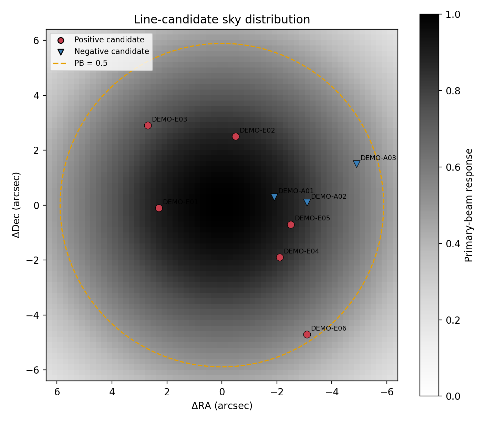
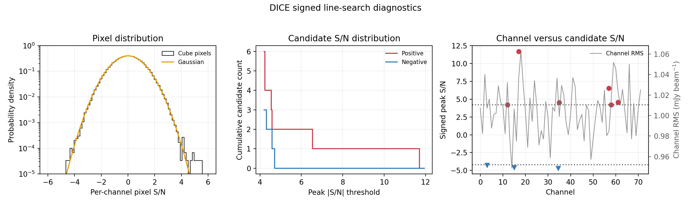

# DICE 学生テスター向けクイックスタート

この文書は、ALMAデータ解析の初歩を身につけた、DICEを初めて使う学生・初学者が「何を実行すればよいか」で迷わないための最短手順です。

DICEは、擬似天体の注入と回収を通じて、特定のデータと解析手順が元の天体集団をどのように回収し、どの程度の偽検出を生むかを測定するための枠組みです。天体抽出は重要な工程ですが、より広い目的は、測定したcompleteness、contamination、flux recovery、位置精度を、補正後の天体数や天体集団の制約へ反映することです。

分からないことがあれば、まずDICEを案内した人（担当教員など）に相談してください。[学生テスター向けFAQ](https://github.com/natsuki-h2/DICE/issues/1)と[DICE Issues](https://github.com/natsuki-h2/DICE/issues)にある過去の質問も参考にできます。問い合わせ方法と送ってほしい情報は、このページの一番下にある「困ったときに送ってほしい情報」にまとめています。

擬似データを使った動作例は、後述する「Optional tutorial C」で実行できます。生成された候補表と確認図は`data/tutorials/line_search_demo/`に保存され、ご自身の出力と比較できます。

Git・GitHubにまつわる専門用語は、次の意味です。

- **repository**：DICEのコード一式をまとめたGitHub上の保管場所
- **clone**：repositoryを初めて自分のPCへコピーすること
- **pull**：すでにコピーしたDICEをGitHub上の最新版へ更新すること
- **root**：`README.md`が置かれているDICEフォルダの一番上
- **modified (`M`)**：Gitで管理されているファイルにローカルの変更がある状態
- **untracked (`??`)**：PC上に新しく作成され、まだGitで管理されていないファイルまたはフォルダ

## Step 0. DICEをPCに用意し、最新版にする

### 0-1. ターミナルを開き、Gitを確認する

ターミナルで次を入力します。

```bash
git --version
```

`git version ...`と表示されれば準備済みです。macOSでGitがない場合は、表示される
案内に従ってCommand Line Toolsをinstallしてください。Windowsでは
<https://git-scm.com/download/win> からGit for Windowsをinstallできます。

### 0-2. 初回だけ：repositoryをcloneする

DICEフォルダをまだ持っていない場合だけ実行します。以下ではDocumentsの下に
置きます。`git clone`がDICEフォルダを作るので、先に`mkdir DICE`を実行する
必要はありません。

```bash
cd ~/Documents
git clone https://github.com/natsuki-h2/DICE.git
cd DICE
```

公開repositoryのため、上のHTTPSコマンドではGitHub accountやloginは不要です。
すでにGitHub用のSSH keyを設定している場合は、代わりに次でもcloneできます。

```bash
git clone git@github.com:natsuki-h2/DICE.git
cd DICE
```

`fatal: destination path 'DICE' already exists`と出た場合は、再cloneせず、次の
「2回目以降」の手順へ進んでください。

HTTPSコマンドで`Repository not found`と表示された場合は、repository URLの綴りと
ネットワーク接続を確認してください。解決しない場合は、エラー全文を担当者へ送って
ください。原MSや未発表データを送る必要はありません。

### 0-3. 2回目以降：作業前に最新版をpullする

すでにDICEフォルダがある場合は、毎回の作業開始時にまず次を実行します。

```bash
cd ~/Documents/DICE
git status --short
```

`git status --short`の後に何も表示されなければ、Gitで確認が必要なローカルの変更は
ありません。ファイル名が表示された場合は、ローカルの変更または新しく作成された
ファイルがあります。その状態でpullを続けず、まず下の例を参考に内容を確認して
ください。解決しない場合は、表示結果を担当者へ送ってください。自分で行った変更を
意図せず失う可能性があるため、理由が分からないまま`git reset --hard`やファイル削除を
実行することは避けてください。
ファイルを一時的に取り除いて動作を確認したい場合は、すぐに元へ戻せるよう、削除せずDICE
フォルダの外へコピーまたは移動してください。

例えば、次の表示はDICE本体の異常ではありません。

```text
M configs/line_search/example.json
?? configs/line_search/my_line_search.json
```

`M`は配布用の`example.json`にローカルの変更があること、`??`は自分で作成した
JSONがまだGitで管理されていないことを示します。自分の解析条件が
`my_line_search.json`に保存されている場合は、配布用templateを元に戻せます。

```bash
git restore configs/line_search/example.json
```

再度`git status --short`を実行し、次のように自分の解析用JSONだけが表示されれば
正常です。このJSONは削除せず、そのままline searchに使用します。

```text
?? configs/line_search/my_line_search.json
```

何も表示されない場合、または自分の解析用JSONだけが`??`で表示される場合は、
次へ進みます。それ以外の表示が残る場合は、担当者へ相談してください。

```bash
git switch main
git pull --ff-only
```

`Already up to date.`と表示されれば最新版です。更新があった場合は、変更された
ファイル数などが表示されます。

### 0-4. repositoryのrootにいることを確認する

```bash
pwd
ls
```

`pwd`の末尾が`DICE`で、`README.md`、`src`、`scripts`、`configs`が見えれば正しい
場所です。別の場所へcloneした場合は、`~/Documents/DICE`を実際の保存場所へ
読み替えてください。以降のコマンドは、すべてこのDICE rootで実行します。

最後にPythonを確認します。

```bash
python --version
```

`Python 3.10`以上が表示されれば先へ進めます。`python: command not found`の場合は
`python3 --version`を試し、成功したら以降の各コマンドでも`python`を`python3`へ
置き換えてください。どちらも動かない場合は、自己判断で複数のPythonをinstall
せず、担当者へOS名と表示されたエラーを送ってください。

毎回必要な最短手順は、次の4行です。

```bash
cd ~/Documents/DICE
git status --short
git switch main
git pull --ff-only
```

## Step 1. DICEのinstallと基本動作を確認する

repositoryのrootで仮想環境を作り、DICEをeditable installします。

```bash
python -m venv .venv
source .venv/bin/activate
python -m pip install -e '.[all]'
python -m pytest -q
python scripts/tutorials/basic_metrics.py
```

最後のコマンドがJSON形式の結果を表示し、
`data/tutorials/products/`に結果とprovenanceを保存すれば成功です。

ネットワークに接続できず、必要なライブラリと`setuptools`が既存Python環境へ
入っている場合は、system packagesを参照するvenvを作って外部downloadを
止められます（通常は上のオンライン手順を推奨します）。

```bash
deactivate 2>/dev/null || true
python -m venv --system-site-packages .venv
source .venv/bin/activate
python -m pip install -e . --no-deps --no-build-isolation
```

この方法でも`Cannot import 'setuptools.build_meta'`と表示される環境では、
installを省略して`PYTHONPATH=src python -m pytest -q`で基本試験だけ実行できます。

Conda環境を使用中でも、その中でさらに`.venv`を作ることはできますが、promptに
`(.venv) (別の環境名)`と二重表示されて混乱しやすくなります。原則として、既存の
Conda環境を`conda deactivate`してから上の`.venv`を作るか、どちらか一方だけを
使ってください。

ここまで成功すれば、DICE本体のinstall確認は完了です。以下のoptional tutorialは
機能紹介であり、自分のline cubeを検索するための必須前処理ではありません。

## Optional tutorial A. JSON形式を見る

`configs/tutorials/basic_examples.json`をテキストエディタで開いてください。
JSONは解析条件を記録するテキストであり、プログラムではありません。
数値やパスを変更できますが、括弧とカンマを削除しないよう注意してください。

このファイルは基本tutorial用です。実データのline searchでは、後述する
`configs/line_search/example.json`をコピーして作った別のJSONを直接使用します。

## Optional tutorial B. Visibility dataへ擬似point sourceを注入する

このtutorialでは、擬似continuum point sourceをmeasurement set（MS）へ注入します。
ここで使用するDICEの機能は、一度に1個のpoint sourceを扱います。continuumと
Gaussian profileの輝線は以下で別々に説明します。extended sourceと偏光のvisibility
injectionは、このtutorialの範囲外です。

### B-1. Continuum point source

DICEは、CASAのcomponent listに擬似天体を登録し、`ft(..., usescratch=True)`で
model visibilityを作り、`uvsub(reverse=True)`でMSへ加えます。
`uvsub(reverse=True)`が変更するのは`CORRECTED_DATA`列で、`DATA`列は変わりません。
注入後MSをimageするときは`CORRECTED_DATA`を使ってください。注入前のreference MSに
`CORRECTED_DATA`がない場合は、referenceの`DATA`と注入後の`CORRECTED_DATA`を比較します。

擬似天体をvisibility dataへ注入するためのスクリプトは、指定したMSをその場で
変更します。**原MSを直接指定しないでください。** まず保存先の空き容量を確認し、
原MSの完全なworking copyを作ります。次は例なので、パスを自分のMSに置き換えて
ください。

```bash
mkdir -p data/tutorials/working
cp -R /path/to/original.ms data/tutorials/working/my_injected.ms
```

MSが大きく、ローカルに完全なcopyを作れない場合は、ここで止めて保存場所を担当者と
確認してください。原MSを上書きして容量を節約しないでください。

次に、DICEに含まれる設定例のJSONを別名でコピーします。
`basic_examples.json`自体は編集しません。

```bash
cp configs/tutorials/basic_examples.json \
  configs/tutorials/my_visibility_injection.json
```

コピーしたJSONの`visibility_injection`を編集します。

```json
"visibility_injection": {
  "vis": "data/tutorials/working/my_injected.ms",
  "direction": "J2000 03h32m39.53769 -27d46m43.5673",
  "flux_jy": 0.0001,
  "spw": "",
  "complist": "data/tutorials/working/my_source.cl"
}
```

- `vis`：擬似天体を加えるworking-copy MS。原MSを指定しない
- `direction`：擬似天体のsky position
- `flux_jy`：擬似天体のapparent flux density（Jy）
- `spw`：CASA `ft`へ渡すSPW/channel selection。空文字列は全SPW
- `complist`：DICEが作るCASA component listの保存先

この手順で使用するCASA `ft`はprimary-beam attenuationを自動適用しません。
したがって、`flux_jy`はMSへ加えるapparent fluxです。intrinsic flux
\(S_{\rm intrinsic}\)の擬似天体をPB response \(p\)の位置へ置く実験では、
`flux_jy = p * S_intrinsic`を自分で計算して指定し、使用したPB値を記録してください。
`complist`に既存のcomponent listを指定すると置き換えられるため、working
directory内の新しい名前を使います。

まず、CASA 6のPython taskが使える環境か確認します。

```bash
python -c "from casatasks import ft; print('CASA tasks available')"
```

エラーが出る場合は、通常のPython環境から本実行せず、使用しているCASA 6の起動方法を
担当者へ確認してください。CASA taskが使える環境で、次のdry runを実行します。

```bash
python scripts/tutorials/inject_point_source.py \
  --config configs/tutorials/my_visibility_injection.json --dry-run
```

dry runではMSを変更しません。表示された`vis`、`direction`、`flux_jy`、`spw`、
`complist`が意図した値で、`vis`がworking copyであることを確認します。問題がなければ、
`--dry-run`を外して本実行します。

```bash
python scripts/tutorials/inject_point_source.py \
  --config configs/tutorials/my_visibility_injection.json
```

正常に終了すると、最後に`data/tutorials/manifests/visibility_injection.json`が
表示され、同じ場所に実行条件と入力を記録したprovenance JSONが作られます。

provenanceの作成だけで、注入した擬似天体の回収が確認されたことにはなりません。原MSと
注入後MSを同じ`plotms`または`listobs`設定で確認し、同じ`tclean`パラメータでdirty
imageを作ってください。注入後−注入前の差分imageで、指定したsky positionに、指定した
apparent fluxのpoint-source responseが現れることを確認します。その後のsource finding、
completeness、contamination評価でも、imagingと検出条件を注入前後で変更しないでください。

### B-2. Gaussian-line point source

輝線の場合も原MSは変更しません。CASAの`mstransform`などを使い、対象のscience
field 1個、SPW 1個だけを含むreference MSを作り、それをさらにコピーして注入用MSを
作ってください。現在のDICEは、安全のため、複数fieldまたは複数SPWを含むMSへの
輝線注入を停止します。

例えば、CASA 6で次を実行します。`field`、`spw`、パスは自分のデータに合わせます。

```python
from casatasks import mstransform

mstransform(
    vis="/path/to/original.ms",
    outputvis="data/tutorials/working/line_reference.ms",
    field="target_name",
    spw="0",
    datacolumn="corrected",
    reindex=True,
)
```

入力MSに`CORRECTED_DATA`列がない場合だけ、`datacolumn="data"`を使います。その後、
ターミナルでreference MSをコピーします。

```bash
cp -R data/tutorials/working/line_reference.ms \
  data/tutorials/working/one_field_one_spw.ms
```

設定例のJSONをコピーして、`visibility_line_injection`を編集します。

```bash
cp configs/tutorials/basic_examples.json \
  configs/tutorials/my_line_injection.json
```

```json
"visibility_line_injection": {
  "vis": "data/tutorials/working/one_field_one_spw.ms",
  "direction": "J2000 03h32m39.53769 -27d46m43.5673",
  "center_frequency_hz": 230000000000.0,
  "fwhm_kms": 300.0,
  "peak_snr": 5.0,
  "rms_jy_per_beam": 0.00002,
  "frequency_frame": "TOPO",
  "complist": "data/tutorials/working/line_model.cl"
}
```

- `direction`：擬似輝線天体のsky position
- `center_frequency_hz`：輝線中心のobserved frequency（Hz）
- `fwhm_kms`：Gaussian lineのFWHM（km s\(^{-1}\)）
- `peak_snr`：注入後のdirty cubeで目標とするpeak S/N
- `rms_jy_per_beam`：peak S/Nを定義するcubeのRMS（Jy beam\(^{-1}\)）
- `frequency_frame`：MSのchannel frequencyと同じ周波数系。通常のALMA MSでは
  `TOPO`であることが多いですが、MSを確認して指定します

Gaussian lineでは、peak flux density \(S_{\rm peak}\)、FWHM
\(\Delta v_{\rm FWHM}\)、integrated line flux \(I_{\rm line}\)の関係は

\[
I_{\rm line}
= \int S(v)\,dv
= S_{\rm peak}\,\Delta v_{\rm FWHM}
  \sqrt{\frac{\pi}{4\ln 2}}
\simeq 1.0645\,S_{\rm peak}\,\Delta v_{\rm FWHM}.
\]

したがって、DICEは

\[
S_{\rm peak}
= \frac{I_{\rm line}}
       {1.0645\,\Delta v_{\rm FWHM}}
\]

として各channel中心でGaussian profileを計算します。例えば
\(I_{\rm line}=1\) Jy km s\(^{-1}\)、\(\Delta v_{\rm FWHM}=100\) km s\(^{-1}\)
なら、\(S_{\rm peak}\simeq9.39\) mJyです。FWHMがchannel幅と同程度以下の場合は
profileが十分にsampleされず、cube上で測る積分値がこの連続関数の値からずれる可能性が
あるため、channel幅も記録してください。

標準的なcompleteness実験では、**一つのcubeではFWHMを固定**し、peak S/N、sky position、
centre frequencyだけを変えた少数の擬似天体を注入します。別のFWHMは別cubeで評価します。
この方法では、source findingに使うsmoothing widthが一意になり、異なる線幅の天体間の
影響を避けられます。標準例は1 cubeあたり5天体です。

DICEの`plan_line_injection_positions`は、同じcube内の中心channelを既定で4 FWHM相当
離して配置できます。多数のpopulationを少ないcubeに詰める必要がある場合だけ、
複数のFWHMを扱うmulti-helix配置を上級オプションとして使います。


**図：標準的な擬似輝線天体の配置例。** 左はPB上のsky positionで、色はinput peak S/N
を示します。右はFWHMを10 channelに固定した5天体のGaussian profileと保護範囲
（4 FWHM）です。別のFWHMは別cubeで評価します。

point sourceの場合、DICEは`peak_snr * rms_jy_per_beam`からapparent peak fluxを求め、
上式を使ってintegrated fluxへ変換します。光度関数などから物理的なintegrated fluxを
直接指定したい場合は、`peak_snr`と`rms_jy_per_beam`の代わりに
`integrated_flux_jy_kms`を使えます。両方を同時には指定しません。

複数天体を同じcubeへ入れる前に、各天体を単独でimagingしたresponse cubeを使って
`line_injection_crosstalk`を計算できます。他の注入天体が各target位置に与える寄与の
絶対値合計が既定の0.2σを超える場合は、batchを分割してください。特に明るい天体は
dirty-beam sidelobeを通じて4σ付近の回収率を変える可能性があります。

最初にdry runで内容を確認します。

```bash
python scripts/tutorials/inject_line_source.py \
  --config configs/tutorials/my_line_injection.json --dry-run
```

表示されたMS、擬似天体のsky position、中心周波数、FWHM、積分fluxを確認した後、
`--dry-run`を外してCASA 6のPython taskが使える環境で実行します。

```bash
python scripts/tutorials/inject_line_source.py \
  --config configs/tutorials/my_line_injection.json
```

正常に終了すると、`data/tutorials/manifests/visibility_line_injection.json`が作られます。
continuumの場合と同様に、注入前のreference MSと注入後MSを対応するdata column以外は
同じ条件でdirty imagingし、差分cubeで指定した位置、周波数、線幅にGaussian lineが
現れることを確認してください。

これらはvisibility injection機能のtutorialであり、line searchの必須前処理ではありません。

## Optional tutorial C. 擬似cubeの性質を把握し、line searchを試す

line searchでは候補表だけを見るのではなく、入力cubeのnoiseとPB、候補の空間・周波数分布を図示し、データの基本的な性質を把握することが重要です。自分のデータを使う前に、小さな擬似dirty cubeとPBで、検索から診断図の確認までを試せます。次の二つを順番に実行してください。

```bash
python scripts/line_search/search_fits_cube.py tutorials/line_search_demo/demo_config.json
python scripts/line_search/plot_candidates.py tutorials/line_search_demo/demo_config.json
```

正常に終了すると、`data/tutorials/line_search_demo/`に候補CSV、provenance JSONと、次の確認図が作られます。

- `candidate_review.pdf`：候補位置のmoment-0、正負contour、spectrum
- `candidate_sky_distribution.pdf`：PB内における正負候補の位置
- `line_search_diagnostics.pdf`：pixel S/N分布、候補S/N分布、channelごとの候補S/Nとnoise level

pixel S/N分布ではnoiseがGaussianに近いか、候補S/N分布ではpositiveとnegativeの個数が閾値とともにどう変わるか、channel–S/N図では特定channelに候補が集中していないか、高いchannel RMSと対応していないかを確認します。最後の二つにはPNG版も作られます。

基準出力は`tutorials/line_search_demo/expected_output/`にあります。このdemoでは3個のpositive lineだけを注入していますが、noiseによる正負の候補も検出されます。候補と真値の対応は`tutorials/line_search_demo/expected_candidate_interpretation.csv`で確認でき、「検出候補がすべて真の天体とは限らない」ことを試せます。



**図：候補の空間分布。** 円はpositive candidate、逆三角形はnegative candidateです。
PBの有効範囲、候補の偏り、画像端への集中がないかを最初に確認します。



**図：line-searchの基本診断。** pixel S/N、候補S/N、channelごとの候補S/Nをまとめ、
最後のpanelにはchannel RMSを重ねています。高S/N候補が高noise channelだけに現れて
いないかも確認できます。

## Step 2. 自分のline cubeを探査する

### 2-1. 入力データを確認する

現在の公開コマンドはMSを直接検索しません。次の二つのFITSファイルを読みます。

1. **`image_fits`**：continuum-subtracted、native-resolutionのdirty spectral cube
2. **`pb_fits`**：同じ画像座標・画素数に対応するprimary-beam response

`image_fits`にはPB-corrected cube（`*.pbcor`）を指定しないでください。

`pb_fits`にはCASAの`*.pb` imageを`exportfits`したものを使います。値は無次元で、
通常はfield中心付近が約1、外側ほど0へ近づきます。

```python
from casatasks import exportfits

exportfits(
    imagename="target.contsub.dirty.pb",
    fitsimage="target.contsub.dirty.pb.fits",
    overwrite=True,
)
```

`impbcor`の出力や`*.image.pbcor`はprimary-beam responseではありません。
それらを`pb_fits`へ指定すると検索maskが誤り、候補が偽の0件になる可能性が
あります。FITS headerの`BUNIT`が`Jy/beam`なら、通常それはPB responseでは
ありません。

また、`image_fits`が本当にcontinuum-subtractedか確認してください。continuumを
差し引いていないcubeでもコマンドは実行できますが、連続光天体が複数の探索幅や
周波数位置で繰り返し検出され、候補表が煩雑になります。さらに、局所baselineや
輝線S/Nの解釈も難しくなるため、通常のemission-line searchでは科学的な信頼性が
下がります。

MSがある場合は、原則としてvisibility domainでcontinuum subtractionを行い、その
contsub MSからdirty cubeを作ります。continuumを利用するabsorption-line searchも
DICEで扱えますが、continuum model、正規化、正負候補の解釈が異なるため、この
クイックスタートでは扱いません。詳細は
`docs/alma_line_search_detectability_guide.md`を参照してください。

### 2-2. 実際に使用するJSONを作る

`configs/line_search/example.json`は単なる説明用表示ではなく、コピーして編集した
ファイルをline-searchコマンドへ直接渡すtemplateです。

配布用の`example.json`自体は編集しないでください。必ず別名でコピーし、コピー
したJSONだけを自分のデータに合わせて編集します。これにより、DICEをpullするとき
に配布版との衝突を避けられます。

```bash
cp configs/line_search/example.json configs/line_search/my_line_search.json
```

`configs/line_search/my_line_search.json`をテキストエディタで開き、少なくとも次を
自分のデータに合わせます。

- `image_fits`：continuum-subtracted dirty cube FITS
- `pb_fits`：CASA `*.pb`をexportしたFITS
- `output_directory`：結果の保存先
- `spw_label`：実際のSPW番号など、結果表に残したいラベル
- `pb_min`：検索するPB responseの下限（例：0.5）
- `noise_mode`：S/Nのnoise規格化。通常は`global`を使います。mosaicや
  明瞭な空間的noise variationがある場合は、まずglobal/local比較を行ったうえで
  `local`を検討します
- `threshold_snr`：候補検出のS/N閾値
- `width_channels`：探索する線幅をchannel数で指定
- `merge_radius_pixels`：同一候補をまとめる空間半径
- `candidate_prefix`：候補IDの先頭文字列

`spw_label`は出力catalogueへ記録するラベルで、検出計算そのものは変更しません。
例えばSPW 25のcubeなら`25`とする方が後から分かりやすくなります。

`noise_mode: "local"`を選ぶ場合は、合成beamのminor-axis FWHMを基準にした
local-noise窓も、例えば`"noise_box_beams": 15`のように指定します。DICEは各
boxcar幅でlocal RMS mapを再計算します。local modeは常に優れているわけではなく、
一様noiseのsingle pointingでは推定誤差を増やすことがあるため、通常の初回searchは
`global`のまま実行してください。PBによる検索範囲は`pb_min`で別に指定します。

### 2-3. Line searchを実行する

```bash
python scripts/line_search/search_fits_cube.py configs/line_search/my_line_search.json
```

正常に終了すると、ターミナルの最後に次のような行が表示されます（件数と保存先は
データによって変わります）。

```text
Wrote .../signed_line_candidates.csv (3 positive, 2 negative)
```

この行が表示され、`output_directory`に次の二つがあれば、line-searchコマンドの
実行は成功です。

- `signed_line_candidates.csv`
- `signed_line_candidates.provenance.json`

`(0 positive, 0 negative)`でもコマンドの実行自体は成功しています。ただし、候補が
本当にないとは限らないため、下記「2-4」の入力確認を行ってください。Pythonの
`Traceback`や`Error`で終了した場合は成功ではありません。

`width_channels`に複数の値を指定すると、DICEがcube内部で各channel幅のboxcar sumと
noise再推定を行います。そのため、通常は実行前に同じcubeを手作業でbinningする
必要はありません。元データがすでにspectral smoothingまたはbinning済みなら、
channel間相関と1 channelあたりの速度幅を考慮してwidth listを選び直してください。

正の輝線候補は`*-E##`、負の吸収線候補は`*-A##`として同じ閾値で検索されます。
これは候補作成までの入口であり、候補の信頼性を自動保証するものではありません。
実行前のcontinuum・pixel分布確認、mask、候補検証、injection/recoveryは
`docs/alma_line_search_detectability_guide.md`に従ってください。

`FITSFixedWarning`で日時や観測所座標の補正が表示されることがあります。処理が
`Wrote ... signed_line_candidates.csv`まで到達していれば、通常このwarningだけを
理由に失敗とは判断しません。warning全文は報告時に残してください。

### 2-4. 出力を確認する

出力先には少なくとも次が作られます。

- `signed_line_candidates.csv`：正負の候補catalogue
- `signed_line_candidates.provenance.json`：入力、設定、commit、実行環境の記録

CSVがheaderだけで`0 positive, 0 negative`となっても、コマンドが正常終了していれば
処理自体は成功です。科学的な結論を出す前に、入力データ、検索設定、検索対象領域が
意図したものになっているか、次の点を確認してください。

1. `pb >= pb_min`となる十分な検索領域があるか
2. `image_fits`が意図したcontinuum-subtracted dirty spectral cubeか
3. imageとPBのsky grid、shape、channel軸が対応しているか
4. search幅が想定する輝線速度幅を覆っているか

入力を確認した後で初めて、`threshold_snr`の比較や追加のwidthを検討します。
特定の天体や輝線周波数を事前に指定しないサーチ（従来blind searchとも呼ばれてきたもの）の結果を見てから都合よく閾値を選ばず、比較する閾値は先に記録して
ください。

### 2-5. 候補の確認図を作る

検索に使用したものと同じJSONを、次のスクリプトへ渡します。

```bash
python scripts/line_search/plot_candidates.py configs/line_search/my_line_search.json
```

`output_directory`に次の図が作られます。

- `candidate_review.pdf`：候補ごとのmoment-0 cutoutとspectrum
- `candidate_sky_distribution.pdf`：PB内における全候補の位置
- `line_search_diagnostics.pdf`：pixel S/N分布、候補S/N分布、channelごとの候補S/Nとnoise level

最後の二つにはPNG版も作られます。これらは候補を目視確認するための図であり、
検出の信頼性を保証するものではありません。候補が0件の場合は図は作られません。

moment-0 cutoutの半径と、図示する候補数はoptionで変更できます。例えば、半径を
12 pixel、|S/N|の高い順に10候補までとする場合は次のように実行します。

```bash
python scripts/line_search/plot_candidates.py configs/line_search/my_line_search.json \
  --radius-pixels 12 --max-candidates 10
```

正常に終了すると、ターミナルの最後に次のような行が表示されます。

```text
Wrote .../candidate_review.pdf (5 candidates)
```

`output_directory`に上記の図と`candidate_plots.provenance.json`があり、PDFを開いて
表示に問題がなければ、作図は成功です。

## 困ったときに送ってほしい情報

DICEの使い方、再現可能なエラー、ガイドの不明点は、GitHubの
[DICE Issues](https://github.com/natsuki-h2/DICE/issues)で`New issue`を選んで
問い合わせられます。日本語・英語のどちらでも構いません。GitHubにloginし、
内容が分かる短いタイトルを付けてください。
repositoryがprivateの間は、DICEへのアクセス権を持つユーザーだけが利用できます。

- 実行したコマンド
- エラーメッセージ全文
- 使用OS、Python版、CASA版
- 使用したconfig JSON
- 出力された`.provenance.json`

原MS、未発表天体の座標、未公開の候補表などはGitHub issueへ添付しないでください。
それらを含む相談は、担当教員またはDICEを案内した担当者へ、研究室で指定された
メールやチャットで連絡してください。判断に迷う場合は、まずデータを添付せずに
問い合わせてください。
